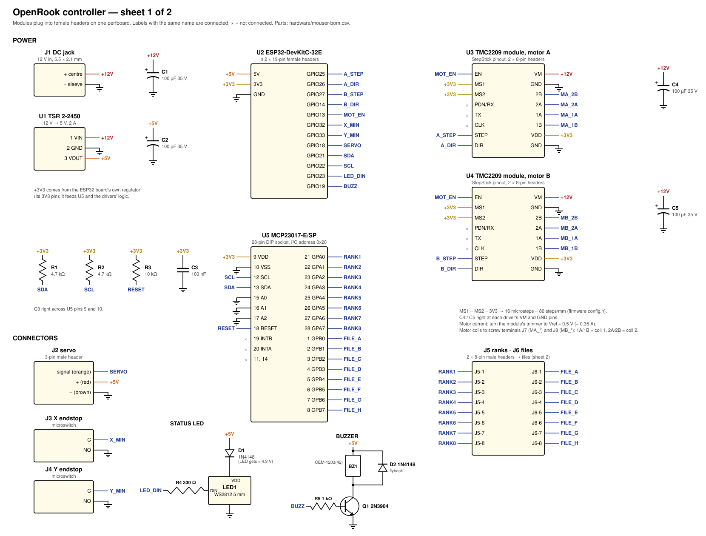
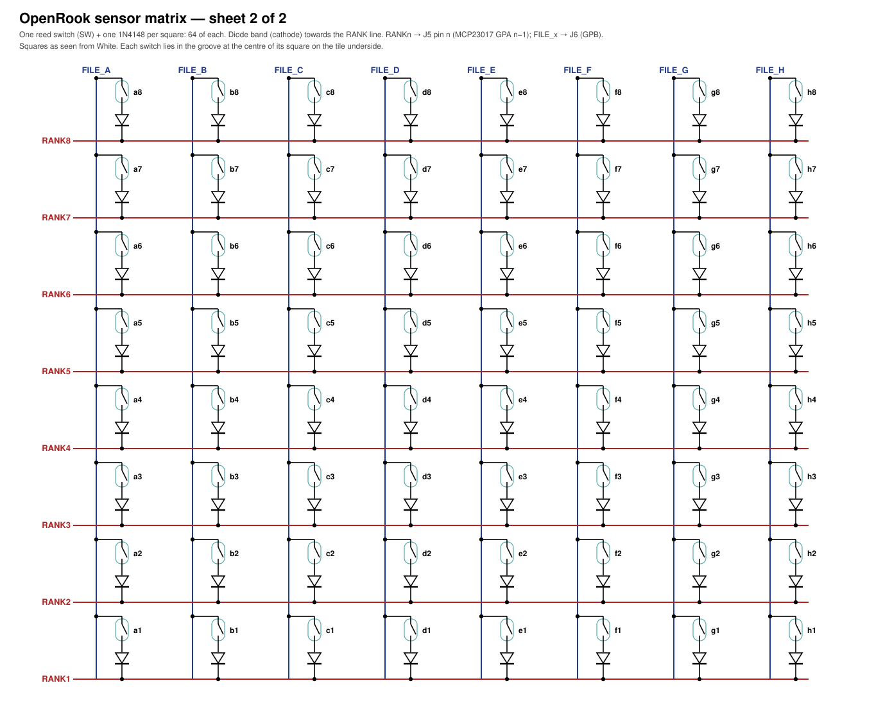

# Circuit and wiring

The circuit is drawn in two sheets (open them in any browser):

- [`schematic/controller.svg`](schematic/controller.svg): power, ESP32, the two stepper
  drivers, the MCP23017, servo, endstops, status LED and buzzer.
- [`schematic/sensor_matrix.svg`](schematic/sensor_matrix.svg): the 64 reed switches and diodes
  under the board.

`schematic/make_schematic.py` draws both; edit it and run `python3 make_schematic.py` to change
them. Part numbers are in [`mouser-bom.csv`](mouser-bom.csv); pin numbers in firmware are in
`firmware/OpenRook/config.h`.



## How it's built

Everything is a plug-in module on one 70 × 90 mm perfboard, so the only soldering is headers,
a handful of passives and wires. The ESP32, the MCP23017 and the two drivers sit in sockets and
can be swapped.

Suggested placement on the perfboard (component side, power jack on the left):

```
 ┌──────────────────────────────────────────────────────────────┐
 │ J1 jack→C1  U1 TSR→C2      [ U3 driver A ] C4  [J7 motor A]  │
 │                            [ U4 driver B ] C5  [J8 motor B]  │
 │ [========  U2 ESP32 DevKitC (2×19 headers)  ========]        │
 │ R1 R2 R3 C3 [ U5 MCP23017 socket ]   J5 ranks  J6 files      │
 │ J2 servo  J3 X  J4 Y   D1 R4 LED1   Q1 R5 BZ1 D2             │
 └──────────────────────────────────────────────────────────────┘
```

Keep the 12 V wires to the drivers short and thick (22 AWG), and put C4/C5 right at each
driver's VM/GND pins. Signal wires can be thin.

## Nets

| Net | Connects |
| --- | --- |
| +12V | J1 centre, C1+, U1 VIN, U3 VM, U4 VM, C4+, C5+ |
| +5V | U1 VOUT, C2+, ESP32 5V, servo red, D1 anode, buzzer + |
| +3V3 | ESP32 3V3, U5 VDD (9), R1, R2, R3, C3, U3/U4 VDD, MS1, MS2 |
| GND | everything's ground (jack, U1, ESP32, drivers ×2 each, U5 VSS/A0/A1/A2, servo, endstops NO, LED, Q1 emitter) |
| A_STEP / A_DIR | ESP32 GPIO25 / GPIO26 → U3 STEP / DIR |
| B_STEP / B_DIR | ESP32 GPIO27 / GPIO14 → U4 STEP / DIR |
| MOT_EN | ESP32 GPIO13 → U3 EN and U4 EN (low = motors on) |
| X_MIN / Y_MIN | ESP32 GPIO32 / GPIO33 → endstop C terminals (internal pull-ups) |
| SERVO | ESP32 GPIO18 → servo signal (orange) |
| SDA / SCL | ESP32 GPIO21 / GPIO22 → U5 pin 13 / 12, with 4.7 kΩ pull-ups to +3V3 |
| RESET | U5 pin 18 → 10 kΩ to +3V3 |
| LED_DIN | ESP32 GPIO23 → R4 330 Ω → LED1 DIN |
| LED1 VDD | D1 cathode (+5V through a 1N4148 ≈ 4.3 V, so the LED reads 3.3 V data reliably) |
| BUZZ | ESP32 GPIO19 → R5 1 kΩ → Q1 base; Q1 collector → buzzer −; D2 across the buzzer |
| RANK1..8 | U5 GPA0..GPA7 (pins 21–28) → J5 pins 1–8 → rank lines in the tiles |
| FILE_A..H | U5 GPB0..GPB7 (pins 1–8) → J6 pins 1–8 → file lines in the tiles |

## Stepper drivers

TMC2209 modules with the standard StepStick pinout (BIGTREETECH and FYSETC both make them):

- **Microsteps**: MS1 and MS2 both to +3V3 = 16 microsteps, which is what the firmware's
  `STEPS_PER_MM 80` assumes (20-tooth pulleys, 1.8° motors).
- **Current**: before connecting a motor, power the board and measure between the trimmer's
  wiper and GND; turn it to **0.5 V** (about 0.35 A, the motors' rating; the load is tiny).
- PDN/UART, CLK and the other pins stay unconnected.
- Motor wires: the Adafruit 324 has four wires, two per coil (check with a multimeter: a coil's
  two wires show a few ohms between them). Coil 1 to 1A/1B, coil 2 to 2A/2B. If a motor turns the
  wrong way, swap one coil's two wires, or flip `INVERT_A_DIR` / `INVERT_B_DIR` in `config.h`.

## The 8×8 sensor matrix



Each square has a reed switch and a 1N4148 in series between its file line and its rank line,
**diode band towards the rank line**. A piece's magnet closes the switch. The firmware pulls one
rank low at a time and reads the eight files (with pull-ups inside the MCP23017); a low file means
a piece is on that square. The diodes stop current flowing backwards through other closed
switches, so every combination of pieces reads correctly.

In the tiles each switch sits in the groove at its square's centre, the diode in the small
groove beside it, the rank wire in the long groove under each row and the file wire in the long
groove beside each column. Use 30 AWG enamelled wire for the long runs (scrape or burn the enamel
off where you solder), join the four tiles' wires at their edges, and bring the 16 lines to J5
and J6 with Dupont wires.

**Test before you glue anything down**: flash the firmware, open *Board* in the app and put a
piece on every square; each one should light up on the screen.

## The gantry

```
   back  ┌──────────────────────────────────────────┐
         │ [Motor A]                     [Motor B]  │
         │    ║                              ║      │
         │ ═══╬══════ X rods (2) ════════════╬═══   │    Y rods along the left and right
         │ [Y carriage]   [centre carriage]  [Y carriage]
         │    ║              magnet arm        ║      │
         │ [idlers]                       [idlers]  │
   front └──────────────────────────────────────────┘
```

CoreXY: both motors are fixed at the back; each belt loops from the carriage round the idlers
(see ASSEMBLY.md for the exact path). The firmware does the maths (A = X + Y, B = X − Y). If a
direction comes out wrong, flip `INVERT_A_DIR` / `INVERT_B_DIR` in `config.h` first; if X and Y
are swapped, swap the motor connectors.

Endstops: X min at the far left of the carriage's travel, Y min at the front. Home is
front-left.
